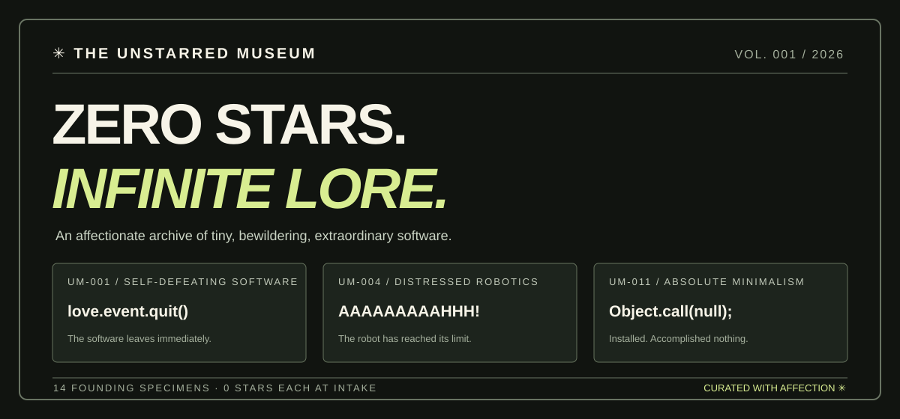

<div align="center">

# ✳ THE UNSTARRED MUSEUM

### Zero stars. Infinite lore.

*An affectionate archive of software nobody asked for, created by people who felt compelled to make it anyway.*

**14 founding specimens** · **0 stars each at intake** · **2016–2026** · **all source-checked**

</div>



There is a mod that closes the game it has just opened. There is a single-file website containing an inert button. There is a robotics project that screams when it cannot find a way forward. These projects deserve a museum.

Welcome to a continually growing cabinet of tiny, baffling, endearing, magnificently specific GitHub repositories.

## The founding collection

| Accession | Specimen | Why we saved it |
| :--- | :--- | :--- |
| **UM-001** | [modthatclosesthegamewhenitopens](https://github.com/AmberNQ/modthatclosesthegamewhenitopens) | A game mod with one immortal instruction: `love.event.quit()`. |
| **UM-002** | [labubu-cli](https://github.com/jmc-ctrl/labubu-cli) | Terminal Labubu. C error handling. A Valgrind testing script. |
| **UM-003** | [nothing](https://github.com/kshaloh/nothing) | One README announcing an empty repository. **24 forks** at intake. |
| **UM-004** | [screamingrobot](https://github.com/dianemagnin97/screamingrobot) | A robot with a stress counter and an escalating response to obstacles. |
| **UM-005** | [PoopyBird](https://github.com/ephman89/PoopyBird) | Described as poop Flappy Bird; its protagonist is named `SPACE_SHIP`. |
| **UM-006** | [useless_machines](https://github.com/YCloudYUSA/useless_machines) | Drupal modules built to uninstall themselves. Surprisingly useful. |
| **UM-007** | [FlyingBanana](https://github.com/Dino12326/FlyingBanana) | An actual Gorilla Tag flying mod; turns off the gorilla's gravity. |
| **UM-008** | [stupid-ass-flexbox-shit-i-hate-frontend](https://github.com/LeonWinde/stupid-ass-flexbox-shit-i-hate-frontend) | A Twitch TTS/social-credit experiment with a magnificently exasperated title. |
| **UM-009** | [uselessWebsite](https://github.com/stevenrASC6/uselessWebsite) | A messaging app storing messages in `const database = [];`, with science GIFs. |
| **UM-010** | [ToasterChan](https://github.com/Elusiveness/ToasterChan) | A 2016 Nightcore community bot, preserved in a README and example module. |
| **UM-011** | [non-op](https://github.com/WaterLemons2k/non-op) | A published npm package. The JavaScript is `Object.call(null);`. |
| **UM-012** | [UselessButton](https://github.com/Toodlebrat/UselessButton) | A literal button with no click behavior whatsoever. |
| **UM-013** | [useless-pile-of-junk-with-a-catchy-name](https://github.com/gabc/useless-pile-of-junk-with-a-catchy-name) | A Common Lisp utility drawer containing MD5-powered terminal color stripes. |
| **UM-014** | [no-egg-to-draw](https://github.com/rmnscnce/no-egg-to-draw) | An eggless collection of single-line identity files. |

All fourteen repositories were checked as public and **zero-starred on 2026-10-10**. Star and fork counts are snapshots. Current totals may change. Each entry in [`data/exhibits.json`](data/exhibits.json) includes a link to the specific file inspected and a tiny excerpt.

## Three artifacts in the special collection

### 001 · The game-closing mod

[AmberNQ/modthatclosesthegamewhenitopens → `main.lua`](https://github.com/AmberNQ/modthatclosesthegamewhenitopens/blob/main/main.lua)

```lua
love.event.quit()
```

The README asks, “What honestly did you expect?” The source delivers.

### 011 · The entire npm package

[WaterLemons2k/non-op → `index.js`](https://github.com/WaterLemons2k/non-op/blob/main/index.js)

```javascript
Object.call(null);
```

A project page, a package manifest, installation instructions, and this one statement. The elegance of doing nothing, distributed through npm.

### 004 · The distressed robot

[dianemagnin97/screamingrobot → `game_code.py`](https://github.com/dianemagnin97/screamingrobot/blob/master/game_code.py)

```python
print "I'm blocked! AAAAAAAAAHHHHHH!"
```

The robotics prototype includes GPIO controls, obstacle checks, a stress counter, and a ten-second scream. The source is an artifact of enthusiastic experimentation; we have made no claim that the code currently runs.

## Explore the museum

This repository includes a **zero-dependency static website** with search, category filters, sorting, a “Surprise Me” button, and expandable source-code drawers.

To run it locally:

```bash
python3 -m http.server 8000
```

Then open **http://localhost:8000**. Everything is plain HTML, CSS, JavaScript, and JSON. No npm install, bundler, or database required.

To publish on **GitHub Pages**, create a public GitHub repository, upload the contents of this folder to its default branch, then go to **Settings → Pages → Deploy from a branch → main → / (root)**. GitHub supplies the published URL once Pages is active.

## How to submit something glorious

The museum welcomes public GitHub projects with **0–5 stars at discovery**. Send the repo link, an actual source-file link, and a short affectionate explanation of why the artifact deserves a display cabinet. Use the [specimen nomination issue template](.github/ISSUE_TEMPLATE/nominate-a-specimen.yml), or see [CONTRIBUTING.md](CONTRIBUTING.md) for the catalog format.

A quick catalog check is included:

```bash
python3 scripts/check_catalog.py
```

## An editorial note

A tiny star count says how a project was discovered, not how well it was made. Some exhibits are serious little tools. Some are jokes. Some are relics of an evening spent trying something strange. We cherish all three, and we credit their makers.

This repo's original museum code and writing are MIT-licensed. Third-party code excerpts remain the property of their respective authors, under the original repositories' terms.

---

<div align="center">

*Long live the weird little corners of the internet.*

**✳**

</div>
